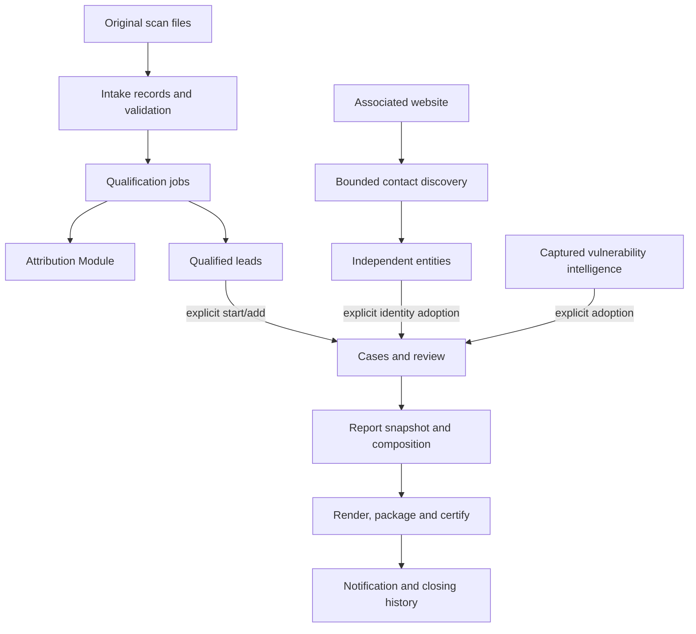
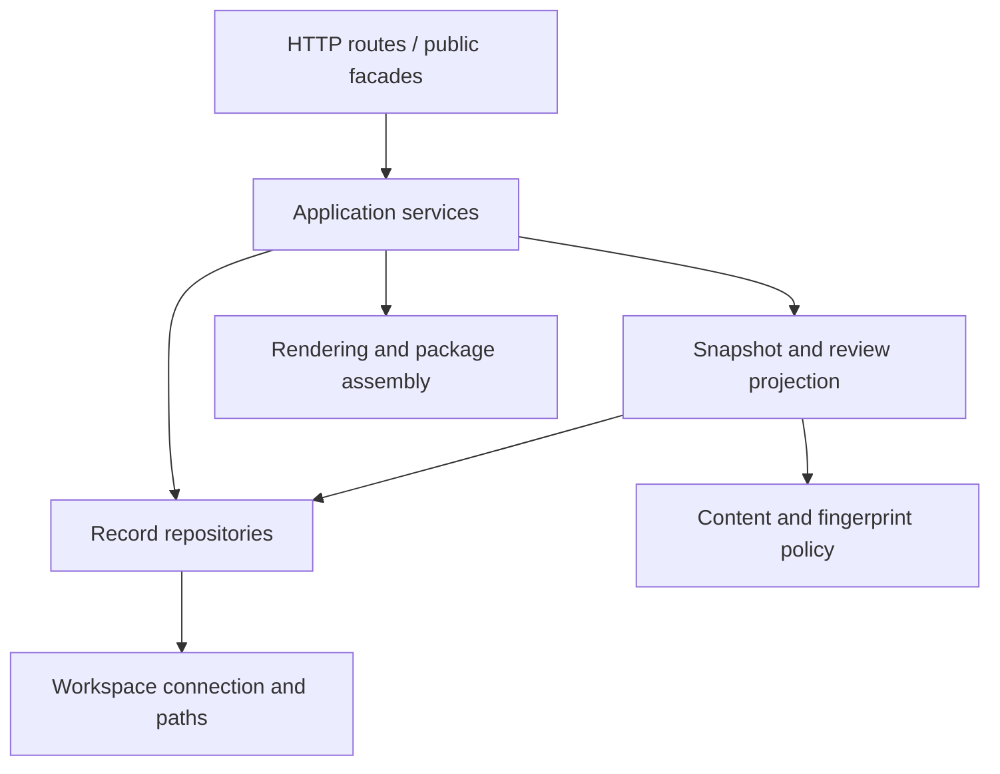

# Shadowserver Eclipse architecture

This reference describes application boundaries and ownership. Use
[Development](DEVELOPMENT.md) for setup and verification, and
[release metadata](RELEASE.json) for the current version and acceptance state.

Open [the interactive program map](docs/program-map.html) to select a component,
trace its imports, inspect source files and public symbols, and find relevant
tests. [The module guide](docs/MODULE_GUIDE.md) explains which level to change.
The map is generated from the checked-out code and the reviewed
[component registry](docs/components.json); it is not a proposed architecture.

The product remains one local application with one separately installable
Attribution Module. Internal packages share the application release and SQLite
workspace. An ownership category on the map does not imply a separate process,
independent package, or complete isolation.

## Data flow

Import dependencies and workflow data flow are different views. The interactive
map shows imports; the diagram above shows how records move through the workflow.

## Responsibility boundaries

| Responsibility | Implementation | Interface / constraint |
| --- | --- | --- |
| Shared input security | `workbench/aegis/` | Standard-library-only antimalware execution, typed errors/receipts, strict JSON and text representation checks; no provider or workflow imports |
| Complete source rows and grouped lead contracts | `workbench/intake/records.py` | `UnvalidatedEntry`, `ValidatedEntry`, `ValidatedLeads`, `QualifiedLeads`; no dropped fields |
| Workbook and CSV reading | `workbench/intake/files.py` | `read_entries(path, sheet)` yields complete rows; `ExcelReader.read()` remains available |
| Pre-lookup policy | `workbench/intake/validation.py`, `domains.py` | `EntryValidator`; offline PSL snapshot and IP checks; no provider requests |
| CVE identification and provider parsing | `workbench/intelligence/identifiers.py`, `adapters.py` | `identifiers`, `summarize`, `summarize_nvd`; pure transformations |
| Request capture and provenance | `workbench/intelligence/acquisition.py` | Owns request budgets, validated response revisions and attempt outcomes; `CapturedSource` keeps data and proof together |
| Published contact discovery | `workbench/contact_discovery/` | `ContactDiscovery.discover`; approved-host scope, bounded requests and HTTPS capture and source-linked candidates; no persistence or adoption |
| Contact results and job coordination | `workbench/contact_records.py`, `contact_jobs.py` | Entity-associated website scope, derived run evidence, candidate revision guards, cancellation and immediate blank-field contact-plan suggestions |
| Source persistence | `workbench/repositories/sources.py` | Atomic current/revision publication, immutable attempts and consistent cache/proof reads |
| Verification and enrichment | `workbench/intelligence/service.py` | `verify`, `enrich`; combines evidence without adopting it into a case |
| Review content policy | `workbench/reviews/policy.py` | Fingerprints, prerequisites and changed paths; no commands, database or HTTP |
| Review status and guards | `workbench/reviews/queries.py` | Reads saved review state; explicit `record_changes=False` avoids stale-event writes |
| Review mutations | `workbench/services/reviews.py`, `repositories/reviews.py` | One service-owned transaction for snapshot/event/case revision writes |
| Workspace infrastructure | `workbench/workspace.py`, `workspace_defaults.py` | SQLite, paths, migration/default setup; no report recovery or case commands |
| Entity/case records and artifacts | `workbench/repositories/entities.py`, `cases.py`, `artifacts.py` | Complete scoped observations from one snapshot; caller-owned mutations; hash-checked package availability |
| Entity edits and JSON exports | `workbench/services/entities.py`, `lead_exports.py` | Preserve merge atomicity and complete grouped rows |
| Certification, closing and recovery | `workbench/services/certification.py`, `closures.py`, `recovery.py` | Stage/rename/commit sequence and interrupted-publication reconciliation |
| Closing document output | `workbench/closing_renderers.py` | Snapshot-to-PDF/DOCX; no workflow transitions |
| Common values | `workbench/primitives.py` | `now`, `uid`, `dump`; no database or business imports |
| Observation map | `workbench/eclipse.py` | Reads shared intake files directly, without importing the intake worker or acquisition service |

`excel_intake.py`, `workbench.cve_sources` and the helper imports from
`workbench.store` preserve existing public entry points. The web application no
longer imports the old intake CLI. Its legacy RDAP client still exists for CLI
compatibility; production qualification uses `RegistrationAttribution` and the
standalone module.

## Aegis: shared input security

`workbench/aegis/` owns reusable validation primitives. Domain adapters choose
allowed formats, limits, provider schemas and business identities; the shared
package does not know about CVEs, entities, reports or workspace records.

Antimalware calls use one bounded executor with a finite capacity and deadline.
A timed-out native call cannot be forcibly terminated, so it retains its capacity
slot until it completes. New calls fail when capacity is unavailable. No caller
may create an unbounded replacement thread or accept an unfinished scan as clean.

JSON and text helpers validate representations before domain validation. They do
not make a provider response authoritative or replace output encoding. Application
consumers share these policies rather than maintaining copies. The separately
installable Attribution Module keeps its own dependency boundary and cannot import
the workbench package.

The component registry enforces stdlib-only shared-security imports and prevents
upward application dependencies. `docs/INPUT_VALIDATION.md` documents the callable
contracts and the response-to-storage/export boundaries.

## Component boundaries

The Attribution Module already has its own API, CLI, policy, store, tests,
package version and wheel. Its bounded HTTP transport is also used by CVE
acquisition. That shared transport is an explicit dependency on the Attribution
package; moving it into another library would require a coordinated dependency
release, not a copy of the implementation.

The report pipeline already separates drafts, snapshots, composition, rendering,
package assembly and certification. `workbench.reporting` is its public facade.
Renderers consume saved snapshots; certification owns publication and workflow
updates. Historical certified files are read as stored.

Browser features use native ES modules and per-application state. Editor, workflow,
queue and settings handlers own their interaction behavior. `events.js` owns the
single delegated listener set; `navigation.js` owns routes and bootstrap.
`createApplication().start()` is idempotent and `destroy()` removes those listeners,
clears owned polling/debounce timers and invalidates stale view updates. Already
submitted server commands may finish; teardown does not roll back an API request.
The shared `ctx.actions` registry remains a runtime integration boundary.
ECLIPSE still exposes its renderer through `window.Eclipse`. These runtime
relationships are described in the registry; the static import graph cannot
infer them.

## Lifecycle and transaction ownership

The former seven-module import cycle is removed. No cycle allowlist remains.
Public facades (`Store`, `SectionReviews`, `reporting`, `closing`) retain call
compatibility while directing work to the owning layer. Lower-level components
must not import these facades or command services to reach a helper.

This diagram describes responsibility/call direction; the interactive map shows
literal imports. Services receive the workspace explicitly. Repository writes
accept the caller-owned SQLite connection and never commit a review independently.
Case revision, section event and frozen snapshot changes therefore roll back as
one operation. Entity and case views use one `Workspace.read_snapshot()` connection
for all related SQL reads, including nested entity projection. It uses `BEGIN` and
`query_only=ON`; it does not reserve a writer in WAL mode. Writes retain explicit
`BEGIN IMMEDIATE`, commit/rollback and optimistic version guards. Python
transaction mode is pinned rather than inheriting a future default. Repositories
accept a supplied connection to observe the command's own uncommitted writes.

Store initializes Workspace, composes entity/artifact repositories and invokes
recovery before job workers start. A bare Workspace initializes its schema/defaults
but does not recover report packages. `describe()` records a newly detected stale
review by default, as before; its `record_changes=False` path is used during
validation and recovery. That side effect is explicit rather than hidden by its
name.

Report certification still stages output, renames the complete package, then
publishes the database record under the workspace lock. A process interruption
between rename and commit is reconciled by startup recovery. Closing publication
retains its existing cleanup/recovery behavior. Compatibility facades pass renderer
functions explicitly so preview/finalization test substitution stays consistent.

## Extension constraints

- Intake and publication/recovery services still contain some aggregate SQL.
  Extract these only while preserving their import and filesystem crash protocols.
  Case, entity and source-cache persistence are now separately owned.
- Browser action calls remain dynamically composed and ECLIPSE remains a global
  renderer. Listener cleanup is explicit; independent component packaging would
  still need narrower render/action interfaces.
- Rendering still expects workspace asset paths and bundled fonts. An independent
  document library needs an explicit asset resolver before it can be separated.
- The older intake CLI has a legacy network path; production uses Attribution.
  Retiring/migrating that path needs deliberate CLI compatibility validation.

A zero-cycle source graph is a useful guard; runtime and data coupling still
require explicit review when extending these boundaries.

## Rules enforced by code

`python tools/program_map.py --check` fails when:

- an owned Python/JavaScript source file lacks exactly one component owner;
- an intake, adapter, observatory, repository, review or standalone-library import crosses a recorded boundary;
- any static import cycle appears;
- a referenced test target disappears; or
- the generated JSON/HTML maps no longer match the source.

The check runs in developer verification and both release builders. Regenerate
with `python tools/program_map.py --write` after intentional changes. Review
registry changes as architecture changes; do not broaden an allowlist merely to
make a failing check pass. No runtime dependency is added by this tooling.

## Stable records and version boundaries

Application release, Attribution package, database schema, snapshot schema,
renderer identity, template version and source-adapter policy are separate
contracts. Contact discovery adds candidate records, derived contact facts and provenance
without rewriting historical report packages or transferring the stable release
approval. The discovery package reads public website content; application services
own persistence, review decisions and explicit contact adoption. Shadowserver API
acquisition uses the integrated client described below and passes imported reports
through the application's intake workflow.

Original rows and captured provider records remain open-ended data. Internal
annotations describe them without truncating fields. Retrieval never silently
adopts a newer revision into casework. Report packaging owns a copy of its input;
section review and certification continue to operate under the existing locks
and transactions.

See [validation](VALIDATION.md) for executed checks and
[security scope](SECURITY.md) for workstation and distribution limits.

The release channel and version-specific Windows acceptance are recorded in
`RELEASE.json`. The current channel is **candidate**; the earlier accepted Windows
baseline does not accept changed code. Passing automated tests cannot promote a
release without the required version-specific confirmation.

## Design references

- [SQLite isolation](https://www.sqlite.org/isolation.html): one snapshot for related
  reads, one writer transaction for cross-record changes. File availability is
  checked separately and is not made transactional by a database snapshot.
- [Python 3.14 sqlite3 transaction control](https://docs.python.org/3.14/library/sqlite3.html#transaction-control):
  this application intentionally retains explicit `BEGIN IMMEDIATE` with
  `LEGACY_TRANSACTION_CONTROL` pinned. Switching to `autocommit=False` would
  implicitly begin a deferred transaction; that is a behavioral migration, not
  a formatting preference. Connections are explicitly closed.
- [MDN event registration](https://developer.mozilla.org/en-US/docs/Web/API/EventTarget/addEventListener)
  and [listener removal](https://developer.mozilla.org/en-US/docs/Web/API/EventTarget/removeEventListener):
  named listener references are retained by one owner and removed on teardown.
  Feature handlers do not install their own document/window listeners.

These references inform the implementation; concurrency, failure-injection and
real-browser checks establish its actual behavior. They are not a certification.

## Lead, report and API ownership

`lead_queue.py` and `lead_queue_migration.py` own pending intake associations and
explicit notification start/add. `repositories/entities.py` and the entity service
own independent profile/contact data. Cases hold a pinned entity snapshot; an
entity edit does not increment every linked case or invalidate its reviews.

`reviews/policy.py` separates content fingerprints from rendered presentation.
`services/reviews.py` persists content locks without creating page artwork.
Certification captures evidence once before the file-only rendering worker;
`appendix_compact.py` builds relevant grouped rows and `evidence_reader.py`
builds the portable reader. Legacy snapshots and revision-specific layouts remain
readable, including their existing artwork.

`api_acquisition.py` coordinates bounded account jobs and receipt-backed intake.
`routes/shadowserver_api.py` provides authenticated local endpoints. The standalone client, including the 0.1.1 download MIME compatibility fix, lives in `workbench/shadowserver_reports`; its source manifest
and acceptance notes are in `components/shadowserver_api`. Account secrets use
session memory or Windows credential storage, outside the workspace database.

