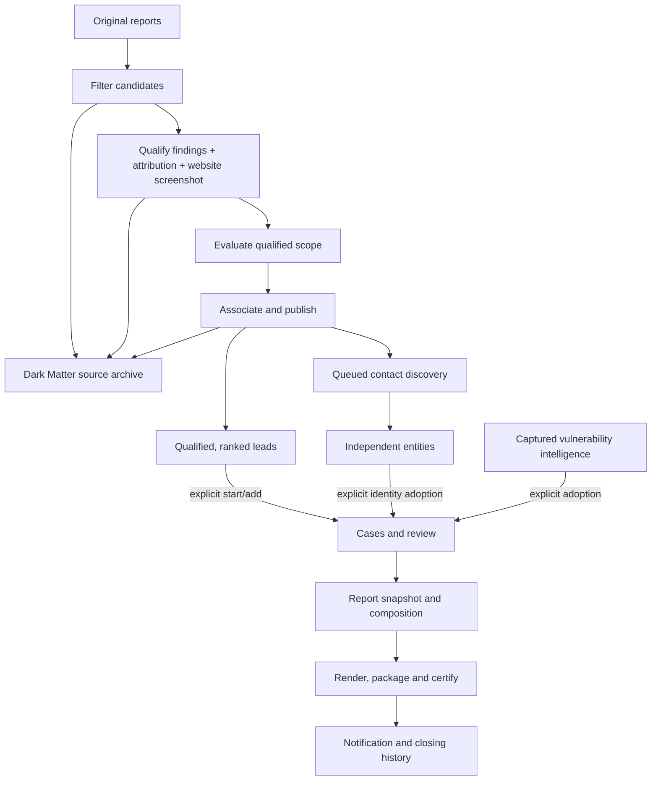
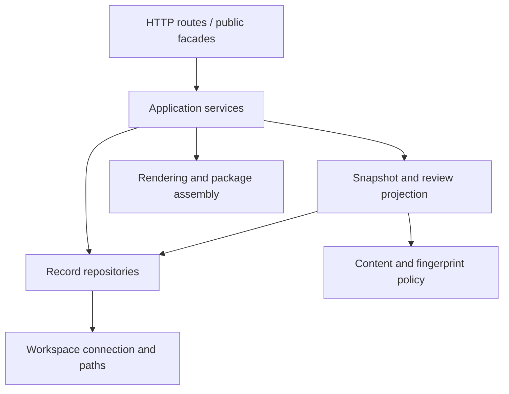

# Shadowserver Eclipse architecture

This is the maintained guide to source ownership, folder placement and runtime
contracts. Use [Development](DEVELOPMENT.md) for setup and verification and
[release metadata](../RELEASE.json) for the current version and acceptance state.
Known problems and planned refactors are tracked in the [issue register](ISSUES.md).

The [interactive program map](program-map.html) shows actual imports, source files,
public symbols and related tests from the checked-out code. Its reviewed
[component registry](components.json) owns import-boundary rules; it is not a
proposed architecture.

The product remains one local application with one separately installable
Attribution Module. The internal modules share the application release and SQLite
workspace. An ownership category does not imply a separate process, independent
database, independently released package or complete runtime isolation.

- [Module ownership and source layout](#module-ownership-and-source-layout)
- [Top-level responsibilities](#what-belongs-at-the-top-level)
- [Runtime data flow](#data-flow)
- [Where to make the next change](#where-to-make-the-next-change)

## Module ownership and source layout

Choose a module from its responsibility, then keep its implementation and
supporting files together.

## Find the owner

| Module | Responsibility | Module guide |
| --- | --- | --- |
| Workspace | Current-work queues, application composition, shared persistence infrastructure, local sessions, backup/recovery, workspace health, and common input security. | [modules/workspace/](../modules/workspace/docs/README.md) |
| Investigations | Cases, drafts, investigation evidence, scoped observations for reports, section review, notification preparation, document composition/rendering, certification, and retained report packages. | [modules/investigations/](../modules/investigations/docs/README.md) |
| Observatory | Read projections, analytical indexes, map/scene interaction, geographic reference assets, and visualization of retained observations. | [modules/observatory/](../modules/observatory/docs/README.md) |
| Entities | Business profiles, entity validation/review, ownership and lifecycle, contact discovery/evidence, contact outcomes, and entity history. | [modules/entities/](../modules/entities/docs/README.md) |
| Leads | Qualified lead queues, frontier/scope selection, lead eligibility policy, and safe lead export contracts. | [modules/leads/](../modules/leads/docs/README.md) |
| Attribution | Registration/DNS matching, attribution evidence, analyst identity approvals, group proof reuse, supplemental asset checks, and the standalone attribution engine. | [modules/attribution/](../modules/attribution/docs/README.md) |
| Accretion (Data) | Source-file intake, original observations, qualification/review orchestration, Evaluate scoring, Shadowserver API acquisition, import progress/reuse, acquisition schedules, and provider schemas. | [modules/accretion/](../modules/accretion/docs/README.md) |
| Library | Local CVE and risk catalogs, provider intelligence parsing/acquisition, reference content, source revisions, catalog search, and reference-data tools. | [modules/library/](../modules/library/docs/README.md) |
| Settings | Guided setup, saved preferences and sender identity, settings presentation, software-update checks, and update handoff. | [modules/settings/](../modules/settings/docs/README.md) |
| Activity | Activity routes, work-log projections and exports, and browser activity presentation. | [modules/activity/](../modules/activity/docs/README.md) |
| UI | Application shell, navigation, delegated events, shared frontend state/session helpers, theme/accessibility primitives, fonts, and shared document geometry/rendering utilities. | [modules/ui/](../modules/ui/docs/README.md) |
| Tools | Reusable runtime tools, including native website capture; consuming modules own their workflow, UI and persistence. | [modules/tools/](../modules/tools/docs/README.md) |

Names in code and paths are lowercase (`accretion` is the Data module). Each
module contains these folders, including tracked placeholders where there is no
content yet:

```text
modules/<name>/
  components/   Feature implementation, including routes/services/repositories
  tools/        Commands and developer utilities specific to this module
  helpers/      Small supporting functions owned by this module
  databases/    Persistence definitions, migrations and documented seed inputs
  static/       Browser JavaScript, styles, images and bundled frontend assets
  tests/        Module regressions, contract tests and feature browser fixtures
  docs/         Responsibilities, operation notes and technical references
  fonts/        Fonts owned by this module, with licenses and provenance
  schemas/      Data contracts, validation schemas and schema provenance
  resources/    Other immutable runtime resources and synthetic examples
```

Cohesive implementation packages remain inside `components/`. Standalone schema
migrations and the coordinated Workspace migration/seed definitions live under
their owner's `databases/`; runtime helpers such as lead queue identity live in
`helpers/`. Database APIs embedded in cohesive catalog/provider packages remain
with those packages. Splitting large mixed-responsibility files belongs to later
targeted refactors. The standalone Attribution package remains intact under
`modules/attribution/components/engine/`, including its own package metadata and
tests. This preserves its independent library contract.

Keep the application source at its current `modules/` paths and the independent
Attribution library in its existing `src/` package layout. Moving the entire
application into another package root would change launch, asset and release
contracts without clarifying domain ownership. Within each owner, use
`components/` for cohesive behavior, `helpers/` for small supporting functions,
and `tools/` for commands. Do not split a cohesive package merely to populate an
empty scaffold folder; its tracked placeholder is sufficient.

`databases/` is for source definitions, never live workspace records, credentials,
downloaded reports, or generated SQLite files. Runtime data continues to use the
existing configured workspace. Shared database transactions, schema versions,
backup formats, and certified artifacts are not changed by this layout.

## What belongs at the top level

The repository root contains application launch/setup entry points, dependency and
tool configuration, release identity, and the project overview and policies. Root `tools/`
owns the full verifier, architecture checker, release builders, and installer.
Root `tests/` owns integration/architecture/release checks and shared harnesses;
root `conftest.py` applies the offline-network and synthetic native-scanner fixtures
to the whole suite and checks shared test-import names before collection. Root
`docs/` holds cross-module guidance, the generated map, and historical records.
Module-specific guides live in their owner's `docs/`.

`modules/tools/` owns reusable tools that run as part of the application.
Root `tools/` remains development, verification, packaging and installer machinery.
For example, Tools loads websites and returns screenshots; Investigations chooses
reported hostnames, queues case work and attaches returned evidence. Tools does not
import the consuming workflow or open its database. A module-specific developer
command still belongs in that module's `tools/` folder.

The retained root files have distinct responsibilities:

| Files or folder | Project-wide responsibility |
| --- | --- |
| README.md | Product overview, first start and entry point to maintained documentation |
| AGENTS.md, SECURITY.md | Source-agent entrypoint and security reporting/trust boundaries; shared contribution and maintenance policy lives in docs/DEVELOPMENT.md |
| CHANGELOG.md | Current/recent release notes consumed by the app; earlier entries live in docs/history/releases/ |
| run.py, Setup.cmd, Start Workbench.cmd, Start Demo.cmd | Application and setup entry points; shared launcher setup lives in tools/ensure_environment.cmd |
| pyproject.toml, conftest.py | Python tooling/test discovery and fixtures shared by every module |
| package.json, package-lock.json | Frontend verification/formatting configuration and locked developer tools |
| requirements.txt, requirements-dev.txt, requirements-constraints.txt | Application/developer dependency selection and generated public-package constraints |
| requirements-windows.txt, wheelhouse/ | Canonical Windows dependency pins/hashes and offline wheels; inventories derive from verified artifacts |
| VERSION, RELEASE.json | Application version plus release channel and exact-version acceptance metadata |
| .gitignore, .gitattributes, .prettierignore | Source hygiene, text handling and formatting exclusions |
| .github/, .vscode/ | Repository automation and optional IDE configuration |
| docs/, tests/, tools/ | Cross-module guidance/history, integration checks/shared harnesses, and project maintenance/release tools |
| modules/ | Owned application modules and their supporting files |

Developer references live in this docs directory. Feature-specific instructions
belong in the owning module's docs directory; links provide the entry points
without maintaining a second copy.

Shared font and rendering assets live under UI. Provider schemas live under their
owning domain. Add a top-level schema only for a contract that genuinely spans the
application; do not use the root as overflow for a module's files.

Module interfaces stay with their owner: public Python entry points in the
cohesive component package and browser exports in that module's `static/`.
Genuinely application-wide interfaces belong under top-level `interfaces/` when
needed, with explicit consumers, tests, ownership and distribution registration.
Create that directory for a concrete shared contract, not as an empty framework.
Keep implementation in the responsible module or clearly owned project utility.
An independently packaged library retains its own public API and must not import
application interfaces to preserve its standalone contract.

Composition uses explicit imports and arguments, with one owner for each
lifecycle. Browser features expose the established `install(ctx)` and
`createHandlers(ctx)` contracts; UI composes owners once and retains delegated
listener teardown. A module should expose a usable interface rather than require
another feature's installer to populate its state first. Preserve distinct domain
policies when standardizing wiring; avoid service locators, import-time
registration and forwarding layers that only hide a dependency.

## Rules for the next file-by-file refactors

1. Choose the owner from the behavior, not the file extension. Put that feature's
   Python, browser code, tools, tests, resources, and documentation together.
2. Use direct imports from `modules.<owner>...`. Keep cohesive internal package
   imports relative where appropriate. Do not recreate the old catch-all source
   directories or add forwarding copies just to retain old source paths.
3. Keep shared code owned. Workspace owns core persistence/security/composition;
   UI owns common presentation. A helper with business policy stays in its domain.
   Share the owning implementation through an explicit interface; do not copy it
   into several modules or create an unowned `common` directory.
4. Preserve explicit service inputs, transaction scope, evidence identity, and
   public HTTP/serialized contracts when moving a responsibility between files.
5. Add or move a regression with its feature. Keep integration checks at the root
   when their purpose is to verify interaction between modules.
   Shared application harnesses live in `tests/support/`; feature builders live
   in `modules/<owner>/tests/support/`. Import explicit support packages rather
   than test entry points. Keep the standalone engine's support package independent.
   Default pytest import mode does not require flat test-directory injection.
6. Update this guide and the owning module's guide when ownership changes. Regenerate and
   check the program map with `python tools/program_map.py --write` and
   `python tools/program_map.py --check`, then run the relevant verification from
   [Development](DEVELOPMENT.md).

Dependencies follow the reviewed component boundaries in `docs/components.json`.
Application composition may import multiple owners; reusable primitives and
repositories must retain their narrower contracts. The owners do not form
an acyclic module graph. The checker enforces source-file import cycles and
specific component rules, so a passing check does not establish full module
isolation or validate runtime action calls and shared database access.

Static assets are served from `/modules/<owner>/static/...`. Only each module's
static directory is public; Python, databases, tests, and other resources must not
be exposed by mounting the whole `modules/` directory.

## Data flow



Import dependencies and workflow data flow are different views. The interactive
map shows imports; the diagram above shows how records move through the workflow.

## Responsibility boundaries

| Responsibility | Implementation | Interface / constraint |
| --- | --- | --- |
| Shared input security | `modules/workspace/components/aegis/` | Standard-library-only antimalware execution, typed errors/receipts, strict JSON and text representation checks; no provider or workflow imports |
| Complete source rows and candidates | `modules/accretion/components/intake/records.py`, `report.py` | `SourceObservation`, `CandidateObservation`, `CandidateGroup`, `Report`, `ReportCandidate`; original fields retained |
| Qualified/evaluated stage products | `modules/accretion/components/qualified_lead.py`, `evaluated_lead.py`, `association.py` | Constructors enforce evidence/report/scope relationships; Associate accepts only `EvaluatedLead` and returns `AssociationResult` |
| Complete source archive | `modules/accretion/components/dark_matter.py` | Independent database and durable component API; no qualification, scoring or canonical writes |
| Workbook and CSV reading | `modules/accretion/components/intake/files.py` | `read_entries(path, sheet)` yields complete rows; `ExcelReader.read()` remains available |
| Pre-lookup policy | `modules/accretion/components/intake/validation.py`, `modules/accretion/components/intake/domains.py` | `EntryValidator`; offline PSL snapshot and IP checks; no provider requests |
| CVE identification and provider parsing | `modules/library/components/intelligence/identifiers.py`, `modules/library/components/intelligence/adapters.py` | `identifiers`, `summarize`, `summarize_nvd`; pure transformations |
| Request capture and provenance | `modules/library/components/intelligence/acquisition.py` | Owns request budgets, validated response revisions and attempt outcomes; `CapturedSource` keeps data and proof together |
| Published contact discovery | `modules/entities/components/contact_discovery/` | `ContactDiscovery.discover`; approved-host scope, bounded requests and HTTPS capture and source-linked candidates; no persistence or adoption |
| Contact results and job coordination | `modules/entities/components/contact_records.py`, `modules/entities/components/contact_jobs.py` | Entity-associated website scope, derived run evidence, candidate revision guards, cancellation and immediate blank-field contact-plan suggestions |
| Source persistence | `modules/library/components/repositories/sources.py` | Atomic current/revision publication, immutable attempts and consistent cache/proof reads |
| Verification and enrichment | `modules/library/components/intelligence/service.py` | `verify`, `enrich`; combines evidence without adopting it into a case |
| Review content policy | `modules/investigations/components/reviews/policy.py` | Fingerprints, prerequisites and changed paths; no commands, database or HTTP |
| Review status and guards | `modules/investigations/components/reviews/queries.py` | Reads saved review state; explicit `record_changes=False` avoids stale-event writes |
| Review mutations | `modules/investigations/components/services/reviews.py`, `modules/investigations/components/repositories/reviews.py` | One service-owned transaction for snapshot/event/case revision writes |
| Workspace infrastructure | `modules/workspace/components/workspace.py`, `modules/workspace/databases/workspace_defaults.py` | SQLite, paths, migration/default setup; no report recovery or case commands |
| Entity/case records and artifacts | `modules/entities/components/repositories/entities.py`, `modules/investigations/components/cases.py`, `modules/investigations/components/repositories/artifacts.py` | Complete scoped observations from one snapshot; caller-owned mutations; hash-checked package availability |
| Entity edits and JSON exports | `modules/entities/components/services/entities.py`, `modules/leads/components/services/lead_exports.py` | Preserve merge atomicity and complete grouped rows |
| Certification, closing and recovery | `modules/investigations/components/services/certification.py`, `modules/investigations/components/services/closures.py`, `modules/investigations/components/services/recovery.py` | Stage/rename/commit sequence and interrupted-publication reconciliation |
| Closing document output | `modules/investigations/components/closing_renderers.py` | Snapshot-to-PDF/DOCX; no workflow transitions |
| Common values | `modules/workspace/components/primitives.py` | `now`, `uid`, `dump`; no database or business imports |
| Observation map | `modules/observatory/components/eclipse.py` | Reads shared intake files directly, without importing the intake worker or acquisition service |

`modules.library.components.cve_sources` and the helper imports from
`modules.workspace.components.store` preserve existing implementation interfaces at their new module paths. Application intake uses the typed
[Accretion pipeline](../modules/accretion/docs/PIPELINE.md) and Attribution's
`RegistrationAttribution` interface. The alternate intake CLI and its compatibility
RDAP adapter are removed; the standalone Attribution engine retains its own CLI.

## Aegis: shared input security

`modules/workspace/components/aegis/` owns reusable validation primitives. Domain adapters choose
allowed formats, limits, provider schemas and business identities; the shared
package does not know about CVEs, entities, reports or workspace records.

Antimalware calls use one bounded executor with a finite capacity and deadline.
A timed-out native call cannot be forcibly terminated, so it retains its capacity
slot until it completes. New calls fail when capacity is unavailable. No caller
may create an unbounded replacement thread or accept an unfinished scan as clean.

JSON and text helpers validate representations before domain validation. They do
not make a provider response authoritative or replace output encoding. Application
consumers share these policies rather than maintaining copies. The separately
installable Attribution Module keeps its own dependency boundary and cannot import
the application's `modules` package.

The component registry enforces stdlib-only shared-security imports and prevents
upward application dependencies. `docs/INPUT_VALIDATION.md` documents the callable
contracts and the response-to-storage/export boundaries.

## Component boundaries

The Attribution Module already has its own API, CLI, policy, store, tests,
package version and wheel. Its bounded HTTP transport is also used by CVE
acquisition. That shared transport is an explicit dependency on the Attribution
package; moving it into another library would require a coordinated dependency
release, not a copy of the implementation.

The report pipeline already separates drafts, snapshots, composition, rendering,
package assembly and certification. `modules.investigations.components.reporting` is its public facade.
Renderers consume saved snapshots; certification owns publication and workflow
updates. Historical certified files are read as stored.

Browser features use native ES modules and per-application state. Editor, workflow,
queue and settings handlers own their interaction behavior. `modules/ui/static/events.js` owns the
single delegated listener set; `modules/ui/static/navigation.js` owns routes and bootstrap.
`createApplication().start()` is idempotent and `destroy()` removes those listeners,
clears owned polling/debounce timers and invalidates stale view updates. Already
submitted server commands may finish; teardown does not roll back an API request.
The shared `ctx.actions` registry remains a runtime integration boundary.
ECLIPSE still exposes its renderer through `window.Eclipse`. These runtime
relationships are described in the registry; the static import graph cannot
infer them.

## Lifecycle and transaction ownership

The static source-file graph has no recorded cycle exceptions.
Public facades (`Store`, `SectionReviews`, `reporting`, `closing`) retain call
compatibility while directing work to the owning layer. Lower-level components
must not import these facades or command services to reach a helper.



This diagram describes responsibility/call direction; the interactive map shows
literal imports. Services receive the workspace explicitly. Repository writes
accept the caller-owned SQLite connection and never commit a review independently.
Case revision, section event and frozen snapshot changes therefore roll back as
one operation. Entity and case views use one `Workspace.read_snapshot()` connection
for all related SQL reads, including nested entity projection. It uses `BEGIN` and
`query_only=ON`; it does not reserve a writer in WAL mode. Writes retain explicit
`BEGIN IMMEDIATE`, commit/rollback and optimistic version guards. Python
transaction mode is pinned rather than inheriting a future default. Repositories
accept a supplied connection to observe the command's own uncommitted writes.
Do not issue network requests inside either a read snapshot or a command transaction.

Store initializes Workspace, composes entity/artifact repositories and invokes
recovery before job workers start. A bare Workspace initializes its schema/defaults
but does not recover report packages. `describe()` records a newly detected stale
review by default, as before; its `record_changes=False` path is used during
validation and recovery. That side effect is explicit rather than hidden by its
name.

Report certification still stages output, renames the complete package, then
publishes the database record under the workspace lock. A process interruption
between rename and commit is reconciled by startup recovery. Closing publication
retains its existing cleanup/recovery behavior. Compatibility facades pass renderer
functions explicitly so preview/finalization test substitution stays consistent.

Shared UI rendering receives cancellation/deadline control through a
[caller-supplied checkpoint](../modules/ui/docs/README.md#rendering-control).
Investigations binds report policy for the operation scope; UI layout does not
import report workflow state. The parent still supervises private render workers.

Installed process lifetime is separate from report supervision. The immutable
native bootstrap coordinates Python startup with installer replacement;
Workspace propagates its running guard to installed workers, and Accretion owns
scheduled-action migration. Installer tooling owns readiness and program-file
ownership. The [guarded-launch protocol](../tools/windows_installer/REFERENCE.md#guarded-launch-and-maintenance)
defines ordering and repair without moving feature policy into the launcher.

The following operations preserve additional consistency contracts:

- Draft saves update the case, legacy projection and event in one transaction.
  Revising a certified report retains the existing package and writes its audit
  event through the caller's connection. Recovery validates the package inventory
  and reconciles only eligible state.
- Entity merges move related records in one transaction and export after commit.
  Entity reads preserve full fields and place the attribution entry first.
  Qualified-lead exports retain their existing JSON contract.
- Provider capture retains matching data and proof. The compatibility
  `cached_json` API continues returning `(JSON, retrieval timestamp)`.

## Runtime integration boundaries

Intake and publication/recovery services own their aggregate SQL transaction and
filesystem protocols. Case, entity and source-cache repositories have separate
ownership within those protocols. Browser actions are dynamically composed,
ECLIPSE uses a global renderer, and listener cleanup is explicit. Document
rendering consumes workspace asset paths and bundled fonts.

Production qualification uses the owned Attribution network boundary; its
standalone engine has an independent command interface. Library uses the engine's
bounded streaming primitive while retaining feed policy, decompression limits
and source adoption. A zero-cycle source graph does not describe these runtime
and data contracts. Proposed changes and completion criteria belong in the
[issue register](ISSUES.md).

## Rules enforced by code

`python tools/program_map.py --check` fails when:

- an owned Python/JavaScript source file lacks exactly one component owner;
- an intake, adapter, observatory, repository, review or standalone-library import crosses a recorded boundary;
- a Python import names a missing module under a known local package or traverses beyond its package;
- a literal local JavaScript import targets a missing file, escapes the source root or uses a nonportable backslash path;
- an unapproved source-file import cycle appears;
- a registered entry path or referenced test target disappears; or
- the generated JSON/HTML maps no longer match the source.

Python imports are inspected even inside functions and conditional branches.
Existing namespace directories and generated/vendor modules can be valid targets
without becoming graph-owned source files. The checker validates the base module
in `from module import name`; it does not verify imported symbols, dynamic
`importlib` calls or unknown absolute package roots that may be third-party code.

JavaScript checks cover literal static imports/exports and `import('...')` calls
using `./`, `../` or `/modules/` paths, ignoring query strings and fragments.
This lexical scan does not replace frontend syntax checks. Computed imports,
template literals, CommonJS `require`, bare imports and other public URL paths
are outside its scope.

Recorded deny rules also apply to namespace imports that have no source-file
edge. Standalone Attribution cannot import application `modules` packages.
The alternate legacy intake CLI has been removed. Shared `modules.ui.helpers`
may depend only on other UI helpers
among graph-owned modules. These are specific contracts, not a blanket ban on
cross-module imports.

The check runs in developer verification and both release builders. Regenerate
with `python tools/program_map.py --write` after intentional changes. Review
registry changes as architecture changes; do not broaden an allowlist merely to
make a failing check pass. No runtime dependency is added by this tooling.

Root pytest configuration and the browser-fixture import helper reject duplicate
direct Python test/helper filenames across root and module test folders, ignoring
case and allowing the standard `__init__.py`/`conftest.py` names. `npm test` checks
the ordered DOM-suite registry against recursively discovered test scripts,
excluding browser suites. See [Development](DEVELOPMENT.md#working-in-a-module)
for the naming rules and the separate browser-suite registration requirement.

## Stable records and version boundaries

Application release, Attribution package, database schema, snapshot schema,
renderer identity, template version and source-adapter policy are separate
contracts. Contact discovery adds candidate records, derived contact facts and provenance
without rewriting historical report packages or transferring the stable release
approval. The discovery package reads public website content; application services
own persistence, review decisions and explicit contact adoption. Shadowserver API
acquisition uses the integrated client described below and passes imported reports
through the application's intake workflow.

Original rows and captured provider records remain open-ended data. Internal
annotations describe them without truncating fields. Retrieval never silently
adopts a newer revision into casework. Report packaging owns a copy of its input;
section review and certification continue to operate under the existing locks
and transactions.

See [validation](history/validation/VALIDATION_0120.md) for executed checks and
[security scope](../SECURITY.md) for workstation and distribution limits.

The release channel and version-specific Windows acceptance are recorded in
`RELEASE.json`. The current channel is **candidate**; the earlier accepted Windows
baseline does not accept changed code. Passing automated tests cannot promote a
release without the required version-specific confirmation.

## Design references

- [SQLite isolation](https://www.sqlite.org/isolation.html): one snapshot for related
  reads, one writer transaction for cross-record changes. File availability is
  checked separately and is not made transactional by a database snapshot.
- [Python 3.14 sqlite3 transaction control](https://docs.python.org/3.14/library/sqlite3.html#transaction-control):
  this application intentionally retains explicit `BEGIN IMMEDIATE` with
  `LEGACY_TRANSACTION_CONTROL` pinned. Switching to `autocommit=False` would
  implicitly begin a deferred transaction; that is a behavioral migration, not
  a formatting preference. Connections are explicitly closed.
- [MDN event registration](https://developer.mozilla.org/en-US/docs/Web/API/EventTarget/addEventListener)
  and [listener removal](https://developer.mozilla.org/en-US/docs/Web/API/EventTarget/removeEventListener):
  named listener references are retained by one owner and removed on teardown.
  Feature handlers do not install their own document/window listeners.

These references inform the implementation; concurrency, failure-injection and
real-browser checks establish its actual behavior. They are not a certification.

## Lead, report and API ownership

`modules/leads/components/lead_queue.py` and `modules/leads/databases/lead_queue_migration.py` own pending intake associations and
explicit notification start/add. `modules/entities/components/repositories/entities.py` and the entity service
own independent profile/contact data. Cases hold a pinned entity snapshot; an
entity edit does not increment every linked case or invalidate its reviews.

`modules/investigations/components/reviews/policy.py` separates content fingerprints from rendered presentation.
`modules/investigations/components/services/reviews.py` persists content locks without creating page artwork.
Certification captures evidence once before the file-only rendering worker;
`modules/investigations/components/appendix_compact.py` builds relevant grouped rows and `modules/investigations/components/evidence_reader.py`
builds the portable reader. Legacy snapshots and revision-specific layouts remain
readable, including their existing artwork.

Accretion coordinates account acquisition and receipt-backed intake. Its
[module guide](../modules/accretion/docs/OPERATIONS.md#shadowserver-reports-integration)
owns the integration, provider compatibility and provenance details. Account
secrets use session memory or Windows credential storage, outside the workspace
database.


## Where to make the next change

Choose the [owner](#find-the-owner), read its maintenance guide and tracker, then
use the [generated source map](program-map.html) to locate implementation, public
symbols and related tests. The map inventories owned production Python and
JavaScript, including tooling and the compatibility CLI; vendor JavaScript, tests,
fonts and schema data are outside that source inventory.

Change the smallest responsible layer, then verify its interfaces using the
[maintenance workflow](DEVELOPMENT.md#maintenance-workflow). These contracts guide
changes that cross module boundaries:

- Intake retains complete rows, physical row numbers, original-file hashes and
  eligibility decisions. Filtering preserves rejection reasons, jurisdiction,
  targeted inclusion and private-IP retention.
- Attribution preserves evidence identity, reviewed versus automatic matches,
  first qualifying match behavior and all grouped observations.
- Contact discovery retains the company apex/www scope, six ordinary requests
  plus two redirects, public-address checks, source evidence and explicit review.
  Adoption preserves hash/path checks, attribution ownership, candidate revisions,
  manual contacts and backup validation.
- Provider handling distinguishes published/rejected/reserved records and unknown
  values from zero or false. Preserve contributor identity, source revisions,
  deadlines, cancellation, endpoint restrictions, validated source bytes,
  stale-data dates and acquisition outcomes.
- Combined intelligence retains independent signals and immutable bank revisions;
  case adoption remains explicit. Explainers retain first-party citations,
  only the sources used, pinned wording and freeze fingerprints.
- PDF and DOCX render the same saved snapshot. Preserve approved emphasis colors,
  page markings, overflow behavior and frozen history. Introduction changes
  preserve explicit revisions, exact wording, one-page scope, native Word prose
  and the retained appendix without migrating existing drafts.
- ECLIPSE retains the original-row denominator, approximate locations and clear
  current-status labels without starting new provider lookups.

Release verification and the upgrade harness are maintained in
[Development](DEVELOPMENT.md); native installation acceptance belongs to the
[installer guide](../tools/windows_installer/README.md).

## Choosing the unit of reuse

- **Function/module:** deterministic transformations, identifiers, formatting and small safety boundaries.
- **Internal package:** a cohesive set of modules with one usable interface, such as intake or intelligence. It ships with the application.
- **Independent library:** separate consumers, explicit inputs/outputs, no application imports, its own tests and a meaningful compatibility/version policy. Attribution meets this standard today.
- **UI component:** owned inputs, state and mount/unmount behavior. Existing feature modules are a start; their shared action registry is still an integration boundary.
- **Application service:** coordinates repositories, providers and user intent. It owns transaction scope rather than hiding commits inside lower-level helpers.

No microservices, plugin discovery framework or new dependency-injection package
is needed for these boundaries. Use direct imports and explicit parameters.
Split packages when consumers or change patterns justify an independent contract.

## Transport contracts

Attribution owns the bounded provider transport also used by CVE capture. Contact
discovery has a separate website transport because it must check every resolved
address, pin the connection to a public IP while retaining the original TLS
hostname, disable ambient proxies/cookies/authentication, and count redirects
inside one discovery budget. Its stricter destination contract is not a drop-in
replacement for the provider transport. Any future extraction of shared transport
code must preserve both contracts and their tests.
