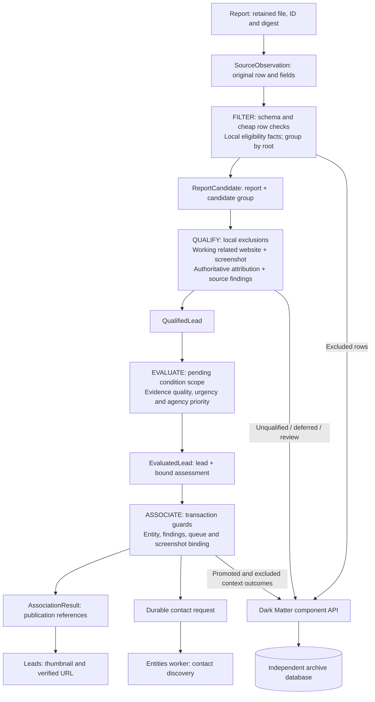

# Accretion pipeline and domain contracts

[Module guide](README.md) · [Report schemas](REPORT_SCHEMAS.md) ·
[Dark Matter](DARK_MATTER.md) · [Operations](OPERATIONS.md)

This specification describes the running application. Planned throughput and
schema extensions remain in the [issue register](ISSUES.md).

## Funnel

Accretion turns source reports into actionable leads. Each stage completes its
own work before the next begins: **Filter → Qualify → Evaluate → Associate**.
Qualify produces the lead; Evaluate ranks it; Associate publishes it and requests
contact enrichment. A high score cannot make incomplete evidence qualify.

These are workflow products, not an ownership tree that deletes source evidence.
A report can contain many candidate groups; one qualified group can support many
canonical findings; an entity's pending lead can combine findings from several
reports and domains. Temporary processing objects can be released while source
files, archive rows, proof, screenshots and canonical history remain retained.

## Stage products

| Product | Enforced contract | Implementation |
| --- | --- | --- |
| `Report` | Nonempty retained ID/name/path and SHA-256. Describes the source without opening it or loading its rows. | [report.py](../components/report.py) |
| `SourceObservation` | Source labels, row position and complete provider fields. Malformed values remain representable for archival; row zero represents a source-level failure. | [intake/records.py](../components/intake/records.py) |
| `CandidateObservation` | Source structure, canonical matching IP and normalized metadata. Filter owns admission policy. | [intake/records.py](../components/intake/records.py) |
| `CandidateGroup` | Nonempty typed membership under one root; tuple membership and frozen attributes. It is not yet a lead. | [intake/records.py](../components/intake/records.py) |
| `ReportCandidate` | Binds a group to its report, checking source filename and any supplied digest. `restore()` applies the same constructors to saved jobs. | [report.py](../components/report.py) |
| `QualifiedLead` | Exact admitted source conditions, supported profile identity, attribution coverage, functioning related screenshot and ownership token. | [qualified_lead.py](../components/qualified_lead.py) |
| `EvaluationScope` / `UrgencyAssessment` | Detached pending-scope inputs and score carrying the matching fingerprint. | [evaluated_lead.py](../components/evaluated_lead.py) |
| `EvaluatedLead` | Qualified product, matching assessment and local CVE references. Its scope contains the exact incoming qualified projection, even when another report/domain supplies the winning queue row. | [evaluated_lead.py](../components/evaluated_lead.py) |
| `AssociationResult` | Report, entity, registered queue row and capture references; observations added and whether new contact work was queued. The queue row may be consolidated into another pending row. | [association.py](../components/association.py) |

Constructors perform structural and relationship validation without database or
network work. Owners verify retained evidence bytes and current state. Raw source
and candidate dictionaries are detached on construction, but are not recursively
read-only; downstream validation checks source/evidence consistency. Qualified
evidence and evaluation snapshots return detached values.

`QualifiedLead.actionable_entries()` projects approved conditions without changing
the original tags. Its `condition_scopes()` indexes those conditions against the
original group rows. Supporting context stays evidence without gaining admission.
The explicit `demonstration()` factory requires labelled synthetic source,
attribution and capture evidence on reserved `.example` domains.

## Entry points

| Call | Input → output |
| --- | --- |
| `filter_report(store, report, config, checkpoint)` | `Report` → `FilterResult`, including typed candidates and archive outcomes |
| `Qualifier.qualify(candidate, refresh=False)` | `ReportCandidate` → `QualificationDecision`; only success carries `QualifiedLead` |
| `complete_lead(store, candidate, attribution, coverage, evidence)` | Automatic or reviewed evidence → validated `QualifiedLead`, after retained-capture integrity checks |
| `evaluate_lead(store, lead, checkpoint=..., config=..., cve_cache=...)` | `QualifiedLead` → `EvaluatedLead` |
| `associate_lead(store, evaluated, db=None)` | `EvaluatedLead` → `AssociationResult` |

`IntakeService` composes these calls and owns import/job lifecycle. Manual reviews
and saved-review reconciliation use the same products. The old standalone
spreadsheet qualifier and recursive matcher are removed. Tests inject provider
responses and capture output at the existing owners' boundaries.

Persisted job payloads keep the established `source`, `ip`, `private_ip` and
`normalized` keys. Serialization happens at persistence boundaries through
`observation_payload()` and `ReportCandidate.payload()`. Report types travel in
`normalized.profile`; there is no separate report-type guessing step in Qualify.

## Filter

[intake_filter.py](../components/intake_filter.py) selects work cheaply and
returns a complete publication result. It performs no website, attribution,
contact or urgency work.

| Sequence | Process | Result |
| --- | --- | --- |
| 1 | Read strict CSV/gzip or selected workbook sheets with container/header/row bounds; ignore wholly empty padding. | Original source rows |
| 2 | Resolve report profile; check required values, jurisdiction, finding/version semantics, hostname and IP. | Structurally admitted row candidates and precise exclusions |
| 3 | Deduplicate CVEs and read local CVSS/KEV/EPSS facts. | Captured facts, not scores |
| 4 | Apply the selected admission mode and group by root domain. Only an eligible row opens a group; valid siblings may supply context. | Eligible groups and remaining row dispositions |
| 5 | Build full observation envelopes for surviving groups, including context facts needed on retry. Bind each group to its Report. | `FilterResult` |
| 6 | Service prepares job JSON and archive deliveries outside the writer; publishes jobs, outbox events, counters and completion marker together. | Durable handoff |

Interruption checks run during bounded processing and before/inside publication.
A completed Filter marker lets retries resume saved groups without rereading or
renormalizing the report. `rows_read` counts nonempty rows; `valid_rows` includes
selected context siblings as well as independently eligible rows. A malformed container with no trustworthy row map
produces a source-level archive failure referencing the original file.

The [schema/admission guide](REPORT_SCHEMAS.md) owns supported families, mode
rules, field requirements and extension steps. Unknown families stay archived;
an inventory entry alone does not enable notifications.

## Qualify

[qualification.py](../components/qualification.py) returns a lead supported by
three evidence classes: source findings, authoritative IP/domain attribution,
and a functioning related website with its screenshot.

1. Read Entities' current ownership/episode context, outreach holds and remaining
   unhandled/unignored findings. Stop before external work for conflicts, holds,
   no remaining work or an entirely nonpublic address group.
2. Call the full [Tools capture API](../../tools/docs/README.md#website-loading-and-capture)
   with usable-content required. Try distinct reported hosts; the shared tool
   supplies bounded HTTP/S, root and `www` fallback. Reuse attempted-URL knowledge
   within the group. One failed host does not discard untried candidates.
3. Retain a functioning related capture through Investigations. A working login
   or admin page counts. Blank, challenge and browser/error output does not.
   A successful unrelated redirect remains `website_identity_review`. A tool
   failure is `website_capture_error`; failed destinations are `website_unavailable`.
4. Recheck ownership after capture. Lazily open Attribution, reuse admissible
   saved proof/approval or obtain fresh RDAP/DNS proof, then stop after a sufficient
   group match. Attribution owns matching, review interpretation and coverage.
5. Construct `QualifiedLead`. Every finding references an original row and an
   actually supported condition/profile; proof covers the group; website evidence
   is related and retained. Otherwise preserve the precise outcome outside Leads.

One sufficient attribution covers the related root-domain group. Current rows
retain their reported IPs; reused proof retains its original evidence IP and
source. A proof does not establish that a website loads, and a page alone does
not establish attribution. No image-based organization classifier is implied.
Cross-root identity assumptions are not manufactured from redirects.

The unsuccessful decision statuses are `dismissed`, `deferred`, `no_public_ip`,
`no_match` and `review`. Reasons distinguish website, attribution and local gates.
`QualificationDecision` rejects contradictory success/lead combinations.
For job transitions, retries and manual review, see [Operations](OPERATIONS.md).

## Screenshots

[Investigations website evidence](../../investigations/components/website_evidence.py)
owns original PNG, preview and metadata retention, hashes, entity binding and
case adoption. Qualify needs no fake entity or case to retain a capture. The
Leads thumbnail and working URL use that evidence; displaying them does not
recapture the page. New/retried qualification captures current website evidence;
saved manual/reconciled acceptance verifies its retained artifact.

Cases adopt the same bytes. Every certified report, including compact output
without an appendix, requires its related screenshot in the Attribution section.
Readiness checks presence, relationship and original/preview/metadata integrity.
Explicit refresh creates a new revision; frozen reports retain their own evidence.

## Evaluate

[evaluation.py](../components/evaluation.py) selects and scores already-qualified
work. Leads owns pending-frontier selection, including merged reports/domains for
one entity. The frontier winner is selected by observation day, creation time and
queue ID; its import supplies the captured policy and evaluation time. Its root
also supplies the provider adjustment. The incoming report is not necessarily
that winner. Handled, ignored and context-only conditions cannot inflate the score.
Evaluate rechecks local ownership/holds, reads retained evidence and local CVE
draft references, and returns one assessment bound to the selected scope.

| Owner | Responsibility |
| --- | --- |
| [scoring_matrix.py](../components/scoring_matrix.py) | Policy defaults, bounds, weights, report bases and policy hash |
| [scoring_evidence.py](../components/scoring_evidence.py) | Local evidence reads and coherent captured CVE bundles |
| [scoring_urgency.py](../components/scoring_urgency.py) | Compare complete urgency candidates |
| [accretion.py](../components/accretion.py) | Pure score assembly and calibration/vetting API |
| [Leads frontier](../../leads/components/lead_frontier.py) | Current pending conditions and publication fingerprint |

The latest complete captured CVE bundle wins deterministically; metrics from
different CVEs/captures are not spliced together. Withdrawn-only rows contribute
no score, while independent report/EOL evidence remains applicable. The strongest
CVE, fallback reported-severity or report-base candidate wins; duplicates and
report bases do not stack. Factors, explanations, policy and evidence stay with
the assessment. No remote lookup or contact discovery runs here.

Default quality weights are data 40, finding 40 and entity 20; urgency weights
are severity 40, KEV 35, EPSS 15 and agency priority 10. Aggregate quality/urgency
weights are 50/50. Temperature thresholds are 40/60/80; provider-owned domains
receive the configured 0.1 aggregate multiplier. These are configurable outreach
priorities, not proof of exposure or scientific certainty.

### Extend the scoring matrix

Add a bounded `report_bases` entry in policy, keyed by exact profile ID or
observation kind, with `value` in 0–1 and an explanatory `reason`. An exact
profile entry overrides its kind. The initial `compromise_indicator` value 0.25
provides 10 urgency points under the default severity weight, or 5 aggregate
points before provider adjustment when stronger evidence is absent. It does not
invent a CVSS score or add a bonus to an already stronger finding.

Use `normalize_policy()` to validate overrides and capture the policy through
the existing import configuration. Extend scoring fixtures and the synthetic
matrix command for intentional changes; do not change qualification or
association to implement a scoring exception. Unchanged scope/current evaluation
version can reuse its assessment. `evaluate_pending()` handles explicit edits to
already-qualified queued work without manufacturing a fresh qualification.

## Associate

[association.py](../components/association.py) accepts only `EvaluatedLead`.
The service owns job guards/completion; Associate can use that caller's
transaction or open its own transaction for standalone publication.

1. Recheck ownership/episode, holds, remaining actionable work, retained report
   identity and the current frontier fingerprint before publication writes.
2. Call [Entities persistence](../../entities/components/repositories/association.py)
   to record entity/domain/source rows, respecting current anchors, case evidence
   and manual profile decisions. Seed only matched registration fields.
3. Queue initial contact work and bind the retained screenshot within the same
   transaction. No contact network request runs in that transaction.
4. Admit exactly the qualified condition scopes through Awareness. Context and
   settled conditions retain evidence without gaining new admission. Use compact
   result/review/queue/capture references.
5. Register the checked score/scope through Leads and enqueue every row disposition
   through the [Dark Matter API](DARK_MATTER.md). The worker commits job completion
   and the export obligation with those publication writes. After commit, the
   existing Entities worker performs bounded contact discovery while intake can
   continue to another group.

`AssociationResult` describes the publication; it does not certify completion of
queued contact discovery or commit an externally supplied transaction. Changes
to mutable ownership/scope require retry/requalification as appropriate; typed
constructors do not replace these live guards.

Entities currently seeds contact crawling from a retained HTTPS apex/`www` site
and may try its approved counterpart. HTTP and other qualified-subdomain seeds
remain [ISS044](../../entities/docs/ISSUES.md#iss044-qualified-website-contact-scope).
That contact limitation does not change Qualify's working-site requirement.

## Sequencing and concurrency

Filter's selection depends on captured facts; normalization depends on selection.
Local CVE reads are deduplicated/batched, and serialization precedes the short
writer transaction. There are no Filter network requests to overlap.

Groups currently qualify serially with one lazy Attribution client per import.
The engine retains its existing concurrent DNS behavior and provider budgets.
No provider request starts before the website gate. Associate's publication is
sequential under one consistent write snapshot; contact discovery is independent
after commit. Existing cancellation/deadline behavior and remaining worker-wide
budgets/paging work are recorded in [ISS027](ISSUES.md#iss027-qualify-decisions-and-workflow).
